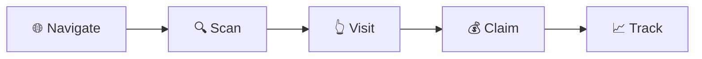

<div align="center">


# AliExpress Coupon Claimer

**Automatically scan your AliExpress orders and claim £1 late delivery coupons**

[](https://www.gnu.org/licenses/gpl-3.0)
[](https://github.com/evenwebb/AliClaimer)
[](https://github.com/evenwebb/AliClaimer)

[Installation](#-installation) • [Features](#-features) • [Usage](#-usage) • [Support](#-support)

</div>

---

## ✨ Features

<table>
<tr>
<td width="50%">

### 🤖 Automatic Scanning
Visits each order and checks for late delivery coupons automatically

</td>
<td width="50%">

### 🎯 Controlled Claiming
Clicks at most one "Collect" control per order, with a configurable attempt limit

</td>
</tr>
<tr>
<td width="50%">

### 🔍 Completed-order coupon status
Automatically checks completed orders in hidden same-origin frames on page load (no tabs or windows are opened). Results are saved locally and reused for 24 hours. A Claim button appears only when AliExpress shows a claimable coupon; confirmed claims are recorded in History. Automatic checks can be switched off in the extension popup.

</td>
<td width="50%">

### 📊 Progress & History
Track scan progress and review claimed, dismissed, and uncertain order outcomes

</td>
</tr>
<tr>
<td width="50%">

### 👁️ Preview Mode
Scan orders to see which have coupons without claiming them

</td>
<td width="50%">

### 🔒 Safe & Secure
No data collection, works entirely in your browser

</td>
</tr>
</table>

---

## 📖 How It Works

When an order isn't delivered within 7 days, AliExpress may offer a **£1 coupon** as compensation. Normally, you have to manually check each order page and click "Collect". This extension automates that process:



1. **🌐 Navigate** - Automatically clicks the "Processed" tab to show only delivered orders
2. **🔍 Scan** - Collects all order links from the page
3. **👆 Visit** - Opens each order detail page in sequence
4. **💰 Claim** - Clicks the "Collect" button when a late delivery coupon is found
5. **📈 Track** - Displays real-time statistics of progress

---

## 🚀 Installation

### From Source (Developer Mode)

> **⚠️ Important:** Choose a permanent location for the extension folder before loading it. Don't delete or move the folder after installation, as Chrome will lose access to the extension files.

1. **Download the Repository**

   Choose one of these methods:

   **Option A - Git Clone (Recommended)**
   ```bash
   # Clone to a permanent location (e.g., ~/Projects/)
   cd ~/Projects/
   git clone https://github.com/evenwebb/AliClaimer.git
   ```

   **Option B - Download ZIP**
   - Click the green "Code" button on GitHub
   - Select "Download ZIP"
   - Extract to a **permanent location** (e.g., `~/Projects/AliClaimer/`)
   - ⚠️ Don't extract to Downloads - it may get deleted!

2. **Open Chrome Extensions**
   - Navigate to `chrome://extensions/`
   - Enable **Developer mode** (toggle in top right corner)

3. **Load the Extension**
   - Click **Load unpacked**
   - Navigate to and select the `AliClaimer` folder
   - Make sure you select the folder containing `manifest.json`

4. **Done!** The extension icon should now appear in your browser toolbar

> 💡 **Tip:** Keep the folder where you put it. If you move or delete it, you'll need to reload the extension.

---

## 💡 Usage

### Basic Usage

<table>
<tr><td>

**Step 1** - Navigate to Orders
```
🌐 Go to: https://www.aliexpress.com/p/order/index.html
```

</td></tr>
<tr><td>

**Step 2** - Start the Extension
```
🔌 Click the AliClaimer icon in your toolbar
```

</td></tr>
<tr><td>

**Step 3** - Claim Coupons
```
▶️ Set the attempt limit and click "Start scan"
```

</td></tr>
<tr><td>

**Step 4** - Monitor Progress
```
📊 Monitor progress, pause/resume, and review History
```

</td></tr>
</table>

### Preview Mode

> **💡 Tip:** Want to see which orders have coupons without claiming them?

1. ✅ Check the **Preview mode** checkbox before clicking Start
2. 🔍 The extension will scan orders and show which ones have coupons available
3. 🚫 No coupons will be claimed - perfect for checking before you claim

### Tips & Tricks

- 🔄 **Scans loaded batches** - AliClaimer follows the English Processed tab and loads available batches, up to a safety limit
- 🎚️ **Set a claim limit** - Choose the maximum claim attempts per run and a pause between orders
- ⏸️ **Pause and resume safely** - Restarts pause the scan; uncertain orders are recorded and not automatically retried
- 🧾 **Review History** - Claimed, dismissed, attempted, and uncertain orders are stored locally; dismiss orders or clear history
- ⚡ **Sequential processing** - Handles one order at a time and performs at most one coupon action per order

---

## 🔍 What It Looks For

The extension currently supports the English AliExpress interface. It searches for **"Collect"** buttons inside `.item-action` elements - specifically the ones that appear with the message:

> *"Sorry for the late delivery. As compensation here's a £1.00 coupon code."*

---

## 🔐 Privacy & Security

<div align="center">

| Feature | Status |
|---------|--------|
| 🚫 No data collection | ✅ All processing happens locally |
| 🌐 No external servers | ✅ Extension doesn't send data anywhere |
| 👁️ No tracking | ✅ Your orders and activities remain private |
| 📖 Open source | ✅ Full code available for review |
| 🔒 Scoped page scripts | ✅ Scripts run on supported order pages; host access also includes AliExpress subdomains |

</div>

### Permissions Explained

This extension requires the following permissions:

- **`storage`** - To save progress and statistics locally
- **`tabs`** - To identify the active order tab and navigate between order pages
- **`alarms`** - To wake the background coordinator if a timer is interrupted
- **`host_permissions (AliExpress)`** - Grants host access to `www.aliexpress.com` and its subdomains; packaged content scripts currently run only on the supported `www.aliexpress.com` order pages

Order history (up to 1,000 records) and scan progress are stored in Chrome extension storage on this device. They are not sent to an external service. Review, dismiss, or clear records from the History view in the extension popup.

---

## 🛠️ Development

### Project Structure

```
AliClaimer/
├── 📄 manifest.json              # Extension configuration
├── ⚙️ background.js           # Durable scan coordinator and recovery
├── 🎨 popup.html              # Scan controls and History view
├── 📜 popup.js                # Popup state and local history
├── 📋 content-order-list.js   # Order-list detection and pagination
├── 📝 content-order-detail.js # Coupon detection and claim confirmation
├── 🖼️ images/                    # Icons and logo
│   ├── icon16.png
│   ├── icon48.png
│   ├── icon128.png
│   └── aliclaimerlogo.png
├── 📖 README.md                  # This file
└── 📜 LICENSE                    # GPL-3.0 License

```

### Contributing

Contributions are welcome! Feel free to open issues or submit pull requests.

---

## ⚠️ Known Limitations

- ⚠️ Only works on AliExpress order pages
- 🔐 Requires manual login to AliExpress
- 🐌 Processes orders sequentially (by design, to avoid rate limits)
- 🏗️ Depends on AliExpress page structure (may break if they redesign)
- 🌐 Requires the English AliExpress interface for coupon button detection
- 🔁 A Chrome restart or extension reload pauses an active scan; review the uncertain order and explicitly resume

---

## 🐛 Troubleshooting

<details>
<summary><b>Extension not starting?</b></summary>

- ✅ Make sure you're on the AliExpress orders page
- 🔄 Try refreshing the page
- 🔐 Check that you're logged in to AliExpress

</details>

<details>
<summary><b>No orders found?</b></summary>

- ⏳ The page may still be loading - wait a few seconds and try again
- 📦 Make sure you have orders in the "Processed" tab
- 📜 Try scrolling down to load more orders before starting

</details>

<details>
<summary><b>Extension stopped working?</b></summary>

- 🏗️ AliExpress may have changed their page structure
- 🔄 Check for updates to this extension
- 🐛 Open an issue on GitHub with details

</details>

---

## 📜 License

This project is licensed under the **GPL-3.0 License** - see the [LICENSE](LICENSE) file for details.

```
Copyright (C) 2025-2026 evenwebb (https://github.com/evenwebb)
```

---

## ⚠️ Disclaimer

> This extension is **not affiliated with, endorsed by, or sponsored by AliExpress**. Use at your own risk. The extension automates manual tasks that you could perform yourself - it doesn't exploit any vulnerabilities or bypass security measures.

---

## 💬 Support

<div align="center">

**Found a bug or have a feature request?**

[](https://github.com/evenwebb/AliClaimer/issues)

[Open an Issue](https://github.com/evenwebb/AliClaimer/issues) • [View Documentation](https://github.com/evenwebb/AliClaimer)

---

**Made with ❤️ by [evenwebb](https://github.com/evenwebb)**

⭐ Star this repo if you find it useful!

</div>
